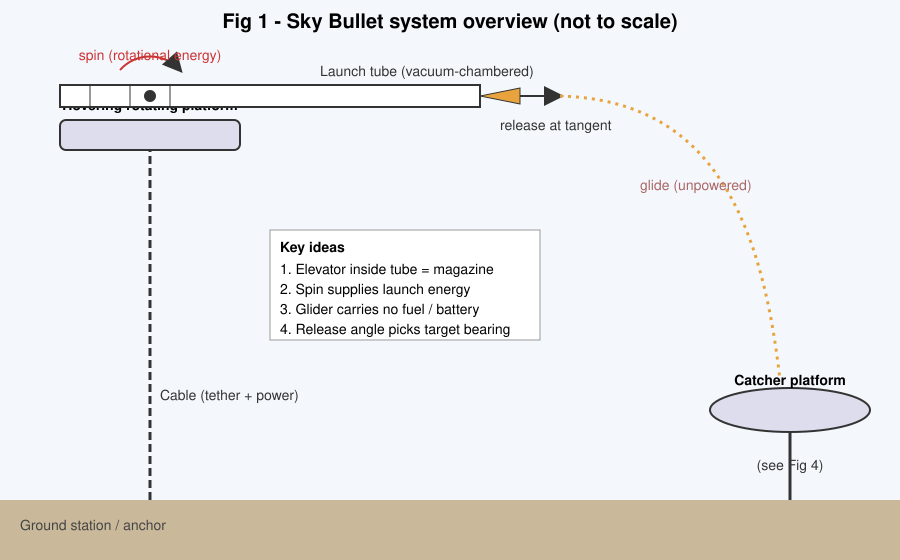
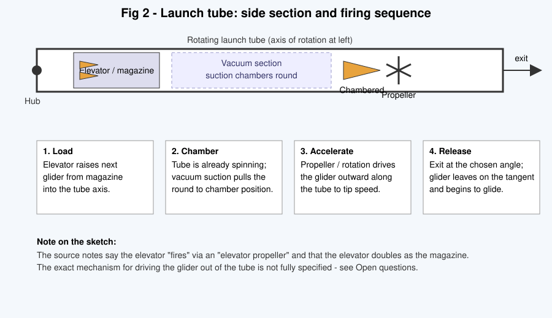
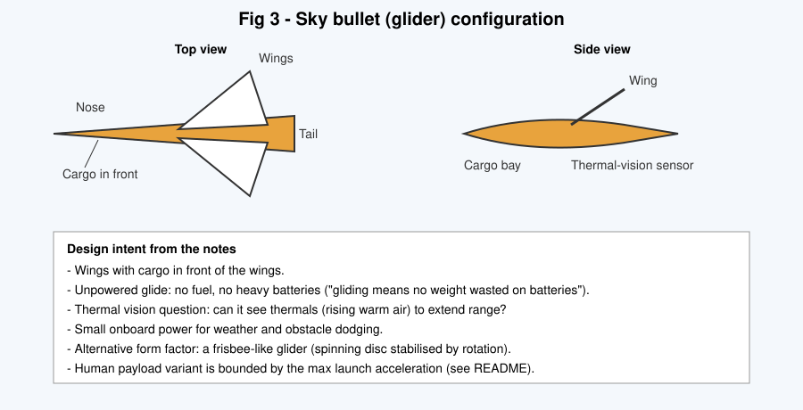
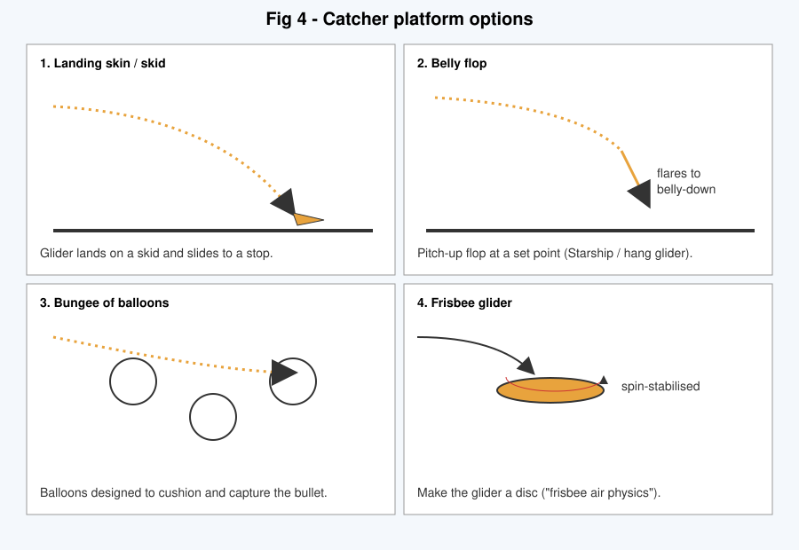
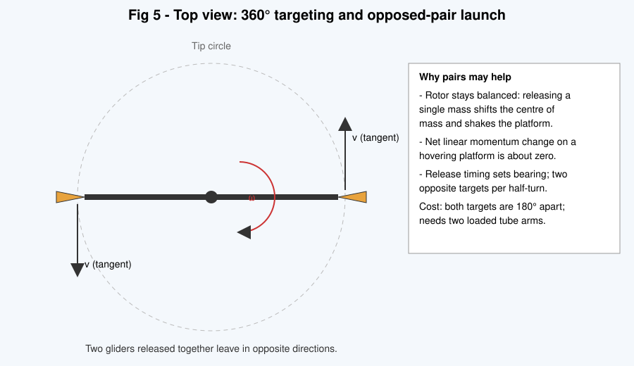

# Sky Bullet: Gliders Launched from a Rotating Tube in the Sky

Concept documentation converted from the hand-drawn notes in `IMG_2276.JPG` and `IMG_2277.JPG`.
This is a concept description, not an engineering spec. Numbers marked *(estimate)* are mine, not from the notes.

## 1. Concept

A hovering platform carries a rotating launch tube. The tube spins, and its rotational energy flings an unpowered glider (the "sky bullet") out along a tangent. The glider flies to a catcher platform. Nothing has to land or take off from the ground, so the launcher carries no landing or takeoff fuel.

## 2. Components

| Component | Role (from the notes) |
|---|---|
| Rotating platform | "Platform is hovering, maybe." Held up by a tether/cable. |
| Cable | Tethers the platform to a ground anchor. The notes leave its function unfinished. Power and tension are the likely roles. |
| Launch tube | Spins continuously, so energy is stored as rotation. |
| Elevator | Moves gliders into the tube. "Elevator is also magazine." |
| Vacuum suction | "Since it's already spinning may as well use vacuum suction to chamber round." |
| Elevator propeller | "Fires sky bullet with rotational energy." |
| Sky bullet (glider) | Winged, cargo in front, unpowered. |
| Catcher platform | Receives the glider (see section 5). |

## 3. Launch sequence

1. **Load.** The elevator/magazine brings the next glider into the tube.
2. **Chamber.** Vacuum suction pulls the round into firing position while the tube spins.
3. **Accelerate.** The glider is driven outward to tip speed.
4. **Release.** The glider leaves on the tangent. The release angle chooses the bearing, which gives the notes' "360° targeting".

## 4. The glider

Why a glider (from the notes' "Why?" list):

- It kills all the fuel cost of landing and takeoff.
- Gliding means no weight is wasted on batteries.
- Range should increase with a powered launch (listed as a physics question).

Small onboard power may still be worth carrying for weather and obstacle dodging.

## 5. Catching the glider

1. **Landing skin/skid.** The glider lands and slides to a stop.
2. **Belly flop.** It flares at a set location, like Starship or a hang glider.
3. **Bungee of balloons.** Balloons designed to catch the bullet.
4. **Frisbee glider.** The glider is a spinning disc, so frisbee air physics applies.

## 6. Launch physics (estimates)

Release speed is the tip speed, `v = ω·r`. The acceleration on the payload at the tip is `a = v²/r`.

| Tip speed | Tip radius | Acceleration |
|---|---|---|
| 100 m/s | 50 m | 200 m/s² (about 20 g) |
| 100 m/s | 200 m | 50 m/s² (about 5 g) |
| 150 m/s | 460 m | 49 m/s² (about 5 g) |
| 200 m/s | 820 m | 49 m/s² (about 5 g) |

For a human payload ("Ergo question: max launch acceleration for humans"), a sustained load of about 5 g is a commonly cited tolerable level for untrained people. That means a bigger radius for a given speed. Cargo gliders can take far more, limited by structure and payload fragility.

## 7. Opposed pairs

The second photo asks: *"Any efficiencies from launching pairs in opposite direction?"*

Likely benefits (my reasoning, to be checked):

- A single release shifts the rotor's centre of mass, which causes imbalance and vibration. Releasing two matched masses at once avoids this.
- On a hovering platform, the net linear momentum change is about zero for a matched pair.
- Two loaded arms per spin means more launches per revolution.

Cost: both targets are 180° apart, so pairing suits two-way traffic better than a single destination.

## 8. Open questions from the notes

- Physics: how much does range increase from a powered launch?
- Can thermal vision see thermals in front of the glider, so it can use them to extend range?
- Maximum launch acceleration for humans.
- How exactly does the elevator propeller push the glider out of the tube?
- What does the cable do besides tethering?
- Is a frisbee form factor better than a winged one?
- Are there efficiencies in launching opposed pairs? (partly answered in section 7)

## 9. Transcription notes

The photos are rotated and the handwriting is rough. Words I'm less sure of: "Ergo Question", the "Cable is..." fragment, "Dual purpose barrel/magazine", and "landing skin/skid". The second photo is a restaurant placemat with only the pair-launch question and a small tube sketch (labelled "any").
